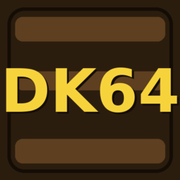

  

# Donkey Kong 64: Recompiled — Android

The Android version of [Donkey Kong 64: Recompiled](https://github.com/Rainchus/Donkey-Kong-64-Recompiled): the
game, statically recompiled, running natively on Android with touch buttons, full controller support and RetroArch
shaders. Made for Android handhelds with a built-in controller and for phones. Tested on the **AYN Odin 2 Portal**
(Snapdragon 8 Gen 2, 1920×1080, Android 13).

This repository is a fork of the main project: branch `main` follows upstream, branch `android` (the default) is
the Android port. It started from [deivid22srk/dk64-recomp-android](https://github.com/deivid22srk/dk64-recomp-android),
the first Android port. The desktop README of the main project is kept as [README-UPSTREAM.md](README-UPSTREAM.md).

> ⚠️ **No game files.** The app contains only this project's code. You need your own legally obtained ROM of
> **Donkey Kong 64 (USA)**, sha1 `cf806ff2603640a748fca5026ded28802f1f4a50`.

## Install

1. Download the `.apk` from the [Releases](../../releases) page and open it on the device (allow installing apps
   from your browser or file manager when Android asks).
2. Start **DK64 Recompiled** and choose **Load ROM**: Android's file picker opens; pick your ROM. It is checked,
   copied into the app and the game starts.

Updates install over the previous version and keep your saves. To get them automatically, add this repository to
[Obtainium](https://github.com/ImranR98/Obtainium) (`https://github.com/almost-drowned-rat/Donkey-Kong-64-Recompiled-Android`).

Needs Android 8.0 or newer, a 64-bit (arm64) device and a GPU with Vulkan. App ID `io.github.almostdrownedrat.dk64`
— it installs next to other DK64 apps.

## Controls

- **Controller**: works out of the box (built-in handheld controls or a Bluetooth / USB pad); set it up in the
  game's settings (Controls).
- **Touch buttons** (N64 layout: stick, A, B, Z, L, R, START, C buttons; D-pad hidden by default). **Automatic**
  hides them while a controller is used and a touch brings them back; **Always** and **Off** are the other modes.
- **Back** (the back gesture, the system bar's back button or a handheld's own Back key) opens the menu over the
  game, fully usable with the controller (D-pad / stick, **A** choose, **B** back, holding the D-pad keeps moving):
  - **Back to the game**
  - **Touch controls** — mode, move and resize, size, single buttons, opacity, stick sensitivity, reset
  - **Settings** — the game's own settings
  - **FPS** — a small readout of the frame rate and frame time in the corner
  - **Exit game**

  With the game's settings open, Back closes them. In all menus **Y** sets the selected setting back to its
  default; graphics settings are applied with **Start**.

## Android settings

Settings > **Android Options** (after Graphics); each line shows what is in use beside it:

- **Shader...** — RetroArch shaders (librashader). None are shipped: **Import shader pack (.zip)** takes a slang
  shader pack such as [libretro/slang-shaders](https://github.com/libretro/slang-shaders)' "Download ZIP"; its
  folders and presets are then listed to pick from.
- **Shader Resolution** — the size of the picture the shader works on: **Original** (the N64's 240 lines, as in
  RetroArch — the look the shaders were made for and by far the lightest), **2x** or **Full**.
- **Shader parameters...** — the active preset's settings (kept per preset).
- **GPU Driver (Turnip)...** — installs a Turnip driver package (`.zip`) or goes back to the system driver; the
  app restarts.

Settings > **More** holds Technical, Manage Mods and Find Mods. There are no window mode options (always full
screen), and the right stick scrolls the menus.

## Known issues

- **Use Turnip on Snapdragon (Adreno) GPUs.** With Turnip the game draws the whole frame at once, which keeps
  water, fire and close geometry right. With the system driver, water can vanish in rectangles and triangles can
  flicker or blow up (RT64 reads the depth buffer it draws to, and Adreno's tiles see stale values); a fix for the
  system driver is still open.
- With the system driver, Android's screen recording can make the GPU hang after a moment.

Report problems on this repository's [Issues](../../issues) page, with the device, Android version and GPU driver.

## Building

On Linux: generate the game code from your own ROM as described in [README-UPSTREAM.md](README-UPSTREAM.md)
(N64Recomp, RSPRecomp, the MIPS patches), build `lib/rt64/src/tools/file_to_c` for the host, apply the patches in
[android/patches](android/patches) to the submodules (`git -C <submodule> apply`), then build the APK with
`./gradlew assembleRelease -PHOST_FILE_TO_C=<path to file_to_c>` in `android/` (NDK, JDK 21). The CI steps are in
[.github/workflows/build.yml](.github/workflows/build.yml); the build architecture is described in
[DESIGN.md](DESIGN.md) and the Turnip integration in [docs/DRIVER-VULKAN.md](docs/DRIVER-VULKAN.md).

## AI assistance

The changes in this Android version were made with AI assistance ([Claude Code](https://claude.com/claude-code)).
Planning, testing on the device and the decision what gets released are by the repository owner. Use at your own
risk. This applies only to this version's own changes, not to the code of the original projects.

## Credits and license

Android:
- [deivid22srk/dk64-recomp-android](https://github.com/deivid22srk/dk64-recomp-android) — the Android port this
  version is based on (NDK build, SDLActivity integration, SAF file bridge, libadrenotools / Turnip, lifecycle)
- [thorskin6657-sudo/dk64-recomp-android](https://github.com/thorskin6657-sudo/dk64-recomp-android) — reference
  for the separate app identity
- [GreenNaugahyde/ZeldaWWHDRecompAndroid](https://github.com/GreenNaugahyde/ZeldaWWHDRecompAndroid) — full-screen
  approach (`hideSystemBars`, MPL-2.0)
- [librashader](https://github.com/SnowflakePowered/librashader) — RetroArch shaders (MPL-2.0 / GPL-3.0)

Game and runtime:
- [Rainchus/Donkey-Kong-64-Recompiled](https://github.com/Rainchus/Donkey-Kong-64-Recompiled) — DK64: Recompiled
  by Rainchus, Ballaam, Killklli, Green Bean and UmedMuzl (see [README-UPSTREAM.md](README-UPSTREAM.md))
- [N64Recomp](https://github.com/N64Recomp/N64Recomp) and [N64ModernRuntime](https://github.com/N64Recomp/N64ModernRuntime)
  by Mr-Wiseguy, [RecompFrontend](https://github.com/N64Recomp/RecompFrontend) (UI design by thecozies)
- [RT64](https://github.com/rt64/rt64) by Dario (DarioSamo), with [plume](https://github.com/renderbag/plume)
- [Donkey Kong 64 decompilation](https://gitlab.com/dk64_decomp/dk64) — headers and ROM tools
- [libadrenotools](https://github.com/bylaws/libadrenotools) by bylaws — custom Vulkan drivers
- [SDL2](https://www.libsdl.org/), [RmlUi](https://github.com/mikke89/RmlUi), [lunasvg](https://github.com/sammycage/lunasvg),
  [zstd](https://github.com/facebook/zstd) and the other libraries in the submodules

License: GPL-3.0, see [LICENSE](LICENSE) / [COPYING](COPYING). The source code of all changes is in this repository.

*Fan project, not affiliated with Nintendo or Rare. Donkey Kong 64 is © Nintendo / Rare.*
